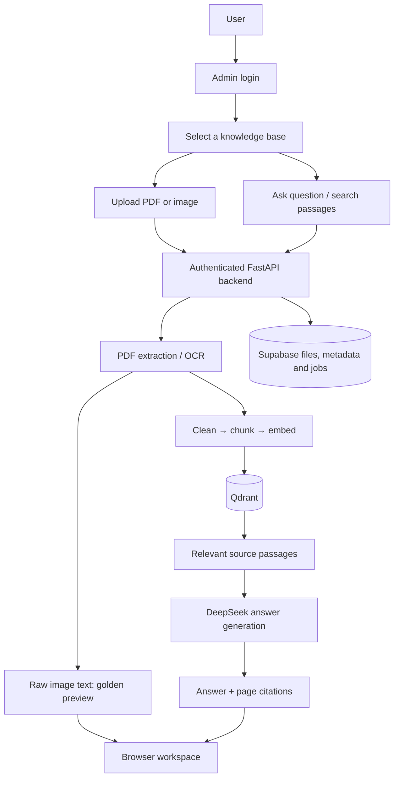

# Query Assistant | Frontend

Query Assistant provides a <span style="color: #8ecbff;"><strong>browser workspace</strong></span> where users can turn their <span style="color: #8ecbff;"><strong>PDFs and images</strong></span> into a collection they can search and ask questions about. Users select or create a <span style="color: #8ecbff;"><strong>knowledge base</strong></span>, upload related files, inspect <span style="color: #8ecbff;"><strong>text recognized from images</strong></span> and receive answers with supporting <span style="color: #8ecbff;"><strong>document excerpts and page references</strong></span>. The interface can help <span style="color: #8ecbff;"><strong>students</strong></span> revise notes, <span style="color: #8ecbff;"><strong>support staff</strong></span> find policy details, <span style="color: #8ecbff;"><strong>researchers</strong></span> explore reports and users review information across multiple documents. It brings uploading, <span style="color: #8ecbff;"><strong>OCR review</strong></span>, <span style="color: #8ecbff;"><strong>passage search</strong></span> and <span style="color: #8ecbff;"><strong>document chat</strong></span> into one place, making stored information easier to access without repeatedly reading every file from beginning to end.

**A document workspace for uploading PDFs and images, inspecting OCR text and asking questions with cited answers.**

Built with HTML, CSS and native JavaScript modules. The browser talks to the [FastAPI backend](../Query-Assistant-backend/README.md); models and provider credentials remain on the backend.

## Workspace features

| Feature | Behavior |
| --- | --- |
| Admin login | Backend verifies credentials; tab-scoped login can resume after refresh |
| Initial state | Every load/refresh shows **Select your knowledge base**, without automatically selecting Customer Support |
| Built-in assistants | Customer Support and Legal Assistant personas |
| Custom knowledge bases | Create, select, rename and delete named document collections |
| Upload | Drag/drop or browse PDFs and images with format/size validation |
| Processing | Local activity stream or resumable cloud page jobs |
| OCR transparency | Raw image text automatically opens in a soft golden panel labelled **EXTRACTED FROM IMAGE** |
| Saved image preview | **View text** reopens OCR text with filename; text can be selected/copied |
| Chat | Follow-up questions and answers with expandable document/page sources |
| Passage search | Relevant excerpts without generating an LLM answer |
| Document management | Page/passage counts, ready/pending state and document deletion |
| Visual design | Responsive dark blue/gold theme, keyboard controls and reduced-motion support |

Upload and document actions stay disabled until a base is selected. Questions require indexed passages. **+ New knowledge base** remains available after connecting, even without a selection.

## Architecture



See the [backend architecture](../Query-Assistant-backend/README.md#architecture-and-data-flow) for detailed ingestion and question flows. Passage search returns retrieved excerpts directly; answer generation is used for chat.

## Models and services behind the interface

Model selections below reflect the inspected development backend configuration on **9 November 2026**, not necessarily a separately deployed environment.

| User action | Model / component | Task | Executes where |
| --- | --- | --- | --- |
| Upload image/scan | Tesseract OCR in current host setup | Recognize printed text; preserve raw preview | Backend host |
| Upload digital PDF | PyMuPDF | Read text layer and inspect images | Backend |
| Enable LLM normalization | DeepSeek `deepseek-chat` | Merge/organize extracted content; rule-based fallback exists | DeepSeek API through backend |
| Index document | OpenRouter `nvidia/nemotron-3-embed-1b:free` | Create current configured 2048-dimensional passage embeddings | Embedding API through backend |
| Ask/search | Same embedding model + Qdrant | Embed query and retrieve passages from selected collection | Backend/services |
| Ask follow-up | DeepSeek `deepseek-chat` | Resolve context into standalone search query | DeepSeek API through backend |
| Generate answer | DeepSeek `deepseek-chat` | Answer from retrieved excerpts with sources | DeepSeek API through backend |
| Save files/progress | Supabase | Private documents, names and processing jobs | Backend → Supabase |
| Open saved image text | Backend preview storage | Read saved raw OCR without requesting a new answer | Backend → browser |

Backend alternatives include local `intfloat/multilingual-e5-small` embeddings and hosted Mistral-compatible `mistral-ocr-latest` OCR. These are alternatives, not extra models called for every action. No browser ML model runs in this frontend. See the [full model table](../Query-Assistant-backend/README.md#models-and-responsibilities).

## API keys and configuration ownership

| Variable / credential | Where configured | Purpose | Browser exposure |
| --- | --- | --- | --- |
| `BACKEND_URL` | Frontend build environment | Public backend origin in built `config.js` | Public; not an API key |
| `PORT` | Local frontend process | Development server port, default `3000` | Not a secret |
| `ADMIN_USERNAME` / `ADMIN_PASSWORD` | Backend; entered by admin at login | Authenticate application requests | Sent with authenticated requests; tab session in `sessionStorage`, never built into assets |
| `DEEPSEEK_API_KEY` | Backend only | Cleanup, follow-up rewrite and answers | Never in frontend configuration |
| `EMBEDDING_API_KEY` | Backend only | Embeddings; currently OpenRouter | Never in frontend configuration |
| `SUPABASE_SERVICE_ROLE_KEY` | Backend only | Private files, metadata and job RPCs | Never in frontend configuration |
| `QDRANT_API_KEY` | Backend only | Remote vector storage/search | Never in frontend configuration |
| `OCR_API_KEY` | Backend only, for hosted OCR | Remote OCR alternative | Never in frontend configuration |
| `CORS_ORIGINS` | Backend environment | Allow exact frontend origin | Not a secret; does not replace authentication |

Tesseract needs no provider API key. The browser does not directly use Supabase/Qdrant SDKs: it accesses those services through the authenticated backend. No actual secret key values belong in either README.

## Supported uploads

| Type | Extensions | Behavior |
| --- | --- | --- |
| PDF | `.pdf` | Digital text extraction and image/scanned-content OCR |
| JPEG / JFIF | `.jpg`, `.jpeg`, `.jfif` | Decode and OCR |
| PNG | `.png` | Decode, flatten transparency onto white and OCR |
| WebP | `.webp` | Decode and OCR |
| Bitmap | `.bmp` | Decode and OCR |
| TIFF | `.tif`, `.tiff` | Process every page |
| AVIF | `.avif` | Decode and OCR with backend Pillow support |

Limit: **4,000,000 bytes per file**. Backend validation checks actual readability and decoded size. Animated PNG/WebP/AVIF use their first frame. A supported format does not guarantee readable text; OCR depends on image quality and text content.

## Quick start

Requirements: Node.js **20+**, a modern browser and matching backend running as **`api_server:app`**.

Start the backend separately using its [setup guide](../Query-Assistant-backend/README.md#setup-and-runtime-modes). From the frontend directory:

```powershell
npm.cmd run dev
```

Open **http://localhost:3000**. On macOS/Linux use `npm run dev`. Windows uses `npm.cmd` to avoid PowerShell script-policy errors. No third-party npm packages or `npm install` are needed by the current implementation.

The local server serves source files directly. Production uses static output from `npm.cmd run build`.

## Demo walkthrough

1. Sign in with backend admin credentials.
2. The dropdown shows **Select your knowledge base**; select a base or create one.
3. Browse/drop a supported file and click **Upload & process**.
4. Watch logs; use **Resume saved documents** for interrupted Supabase jobs.
5. Inspect an image's golden OCR preview; reopen it later with **View text**.
6. Ask a question or select **Search passages**.
7. Expand sources to inspect filenames, pages and excerpts.
8. Refresh: login may resume in this tab, but base selection starts empty. Select the saved base to continue.

Multiple related documents can belong to a base. Retrieval uses only its collection. Rename preserves content; document deletion removes its vectors and saved preview. Local reset keeps source files; cloud reset is disabled in favor of individual deletion/re-upload.

## Browser state and processing settings

| State / setting | Location or behavior |
| --- | --- |
| Selected knowledge base | Page memory; intentionally empty after reload |
| Chat/search conversation | Page memory; cleared on reload |
| Admin login | Backend-scoped credentials in memory and tab `sessionStorage`; logout clears session |
| Backend URL override | Browser `localStorage`, key `pagewise-api` |
| Documents, vectors and base names | Persisted by backend, independent of page refresh |
| Use LLM normalization | Optional model-assisted backend cleanup |
| Reprocess existing PDF | Local forced ingestion; disabled for cloud jobs |
| Retrieved passages | `1–20`, default `5` |
| Clear conversation | Clear active view, not stored documents |

**Processing settings → Connection settings** accepts the backend origin, such as `http://localhost:8000` or `https://your-backend.vercel.app`; an optional trailing `/api` is normalized.

Connection priority: saved override → build-time `BACKEND_URL` → local `http://localhost:8000` or hosted same origin. Credentials are scoped to that backend. This static app does not load backend `.env` files.

## Backend integration

| Operation | Endpoint | Handling |
| --- | --- | --- |
| Login/resume | `GET /api/auth/session` | Verify credentials |
| Load bases | `GET /api/domains` | Populate dropdown with empty placeholder first |
| Status | `GET /api/domains/{key}/status` | Display ready/pending files and passages |
| Upload | `POST /api/domains/{key}/ingest` | Multipart file and options |
| Local processing | Same upload endpoint | Parse NDJSON `log`, `done`, `error` |
| Cloud processing | `POST /api/domains/{key}/documents/{hash}/step` | Continue jobs until `ready` |
| Image preview | `GET /api/domains/{key}/documents/{hash}/text` | Render raw OCR safely as text |
| Chat | `POST /api/domains/{key}/ask` | Answer and sources |
| Passage search | `POST /api/domains/{key}/search` | Excerpts without answer generation |
| Delete document | `DELETE /api/domains/{key}/documents/{hash}` | Confirm, delete, refresh |

See the [complete API reference](../Query-Assistant-backend/README.md#api-reference) for create/rename/delete/reset contracts. Health/docs also require authentication; HTTP 401 returns the browser to login.

## Project structure

```text
Query-Assistant-frontend/
├── assets/          # Logo and visual assets
├── index.html       # Workspace, login, dialogs and OCR panel
├── styles.css       # Dark theme and soft golden OCR text
├── app.js           # Selection, uploads, preview, chat and interactions
├── api.js           # Credentials, HTTP, streams and cloud jobs
├── config.js        # Development public backend configuration
├── build.mjs        # Generate dist/ and public config
├── server.mjs       # Local static development server
├── vercel.json      # Static deployment settings
├── tests/           # API/session/stream regression checks
└── package.json     # Development, build and verification commands
```

## Verification

```powershell
npm.cmd run check
npm.cmd test
npm.cmd run build
```

Syntax checks cover modules/scripts. Tests cover backend-scoped sessions, stream boundaries, failed/incomplete ingestion, HTTP errors and cloud job continuation. They do not establish browser layout or live provider availability.

Manual UI checks: refresh with empty base selection → choose base → upload image → inspect golden text → ask/inspect sources → reopen saved text → logout.

## Deployment

The checked-in `vercel.json` defines a **static deployment**:

| Setting | Value |
| --- | --- |
| Framework preset | Other |
| Root directory | `Query-Assistant-frontend` for combined workspace; repository root for frontend-only repository |
| Build command | `npm run build` |
| Output directory | `dist` |
| Frontend environment | `BACKEND_URL=https://your-backend.vercel.app` |
| Backend environment | Exact frontend origin in `CORS_ORIGINS`; credentials/providers configured separately |

`server.mjs` is local development tooling, not a Vercel serverless entry point. Build exposes only the public backend URL in `dist/config.js`. Deploy matching backend code too: frontend deployment cannot add API routes. Without `BACKEND_URL`, hosted builds use their own origin and need a same-origin API/proxy.

Live Tesseract OCR needs its executable and Python dependencies installed on the backend host. Otherwise select hosted OCR. See [backend deployment instructions](../Query-Assistant-backend/DEPLOY_VERCEL.md).

## Troubleshooting

| Symptom | Action |
| --- | --- |
| Empty selection after refresh | Expected; select a base. Saved documents remain stored |
| Upload disabled | Select a knowledge base |
| Question box disabled | Select a base with indexed passages or finish an upload |
| Preview route not found | Restart/deploy matching updated `api_server:app` |
| Cloud document incomplete | Resolve backend error; **Resume saved documents** |
| Search works, answers fail | Check backend DeepSeek configuration/quota |
| Backend unreachable / requests blocked | Check origin, HTTPS, server and CORS |
| Wrong backend after deployment | Inspect Connection settings override and `BACKEND_URL` |
| Old styling visible | Refresh with **Ctrl+F5** |
| Login fails | Check admin credentials; provider API keys are not login credentials |

## Presentation summary

> The frontend is the user's control panel. It sends authenticated files and questions to the backend, displays progress and original OCR text, and presents answers with supporting document sources. AI models and provider credentials stay on the backend.

Presentation sequence: **blank selection → choose/create base → image upload → OCR highlight → question → cited answer → refresh → saved document preview**.
